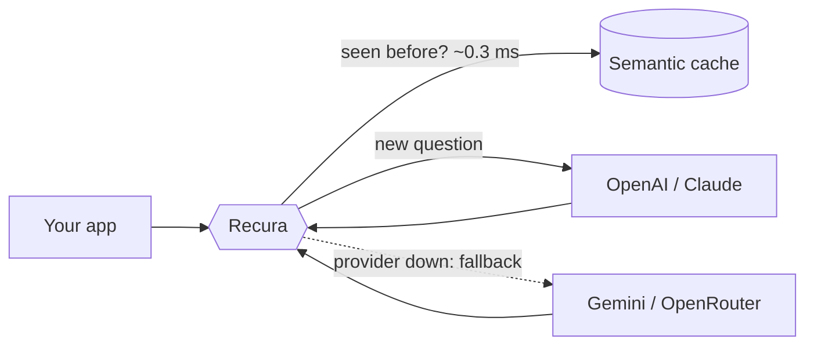

**B.Tech Mathematics & Computing @ RGIPT (2023–2027)**

I build products end to end: the interface, the API, the database, the cloud deploy, and lately the infrastructure that sits between apps and AI models.
I like real-world problems, solid systems, clean and accessible UIs, and solving things with data structures & algorithms.

`Go` · `Python` · `React` · `AWS` · `LLM infrastructure` · `500+ DSA problems` · `JEE Advanced qualified`

---

## 🔁 Flagship project: Recura

**Recura is an open-source LLM gateway written in Go.** It sits between an app and its AI providers and stops the app from paying twice for the same question, even when users word it differently or ask in Hinglish.

- 🔁 **Semantic cache:** matches questions by meaning and answers repeats in **~0.3 ms**
- 🎯 **Safe by design:** on the benchmark, **70% answered from cache with 0 wrong answers**; when unsure, it asks the model
- 🔒 **Privacy rules:** prompts with OTPs, card numbers or UPI IDs are never cached
- 🛟 **Provider fallback** with circuit breakers across OpenAI, Claude, Gemini and OpenRouter
- 🚦 **Per-user rate limiting** (Redis-backed) and **request coalescing**
- 📊 OpenAI-compatible API with streaming, Prometheus metrics and a Grafana dashboard
- ⚙️ One binary, zero external Go dependencies, CI on GitHub Actions, deployed on AWS

[**▶ Try the live demo**](http://recura-demo.ap-south-2.elasticbeanstalk.com) · [**Code**](https://github.com/Prm01/recura) · [**Watch the 1:45 demo**](https://github.com/Prm01/recura/blob/main/internal/server/static/media/recura-demo.mp4) · [**Design decisions**](https://github.com/Prm01/recura/blob/main/docs/ARCHITECTURE.md)

---

## ⭐ More projects

| Project | What it does | Stack |
| --- | --- | --- |
| 🌡️ **[Rahat](https://github.com/Prm01/Rahat)** ([live](https://d17rx6mkixl5iz.cloudfront.net/)) | Heat and flood early warning for Delhi's 290 wards, with a citizen reporting app, AI-drafted alerts in English and Hindi, a chat/voice assistant, an MCP server and Web Push alerts. Built for Hackathon 2026. | Python, FastAPI, PostgreSQL, Docker, AWS (Bedrock, Rekognition, S3, RDS, CloudFront) |
| 📜 **[BhoomiAI](https://smart-land-digitization.vercel.app/)** | Land record digitization and validation: OCR and Agentic AI verification of handwritten Hindi/English records (92% field accuracy), with human review and an audit log. Smart India Hackathon. | Python, TrOCR, LangChain, Streamlit |
| 🏥 **[Doctor Appointment System](https://full-stack-project-1-vau7.onrender.com/)** | Full-stack booking and payments platform with Patient, Doctor and Admin dashboards. | MERN, JWT, Tailwind CSS |
| 📊 **[Finance Dashboard UI](https://finance-dashboard-ui-1.onrender.com/)** | Responsive finance dashboard interface. | React |

---

## 🚀 About me

- 🎓 B.Tech in Mathematics & Computing at **RGIPT, Jais** (2023–2027)
- ⚙️ Backend & systems: **Go, Python (FastAPI), Node.js, Express, PostgreSQL, MongoDB, Redis**
- 🎨 Frontend: **React, Tailwind CSS, JavaScript**, built with accessibility in mind (Lighthouse 100, WCAG 2.1 AA)
- ☁️ Cloud & DevOps: **AWS**, Docker, CI/CD with GitHub Actions, Prometheus & Grafana
- 🤖 AI: LLM gateways and caching, Agentic AI, Transformers, time-series forecasting
- 🌍 Open source: contributed to **Learning Unlimited** and **Neutralinojs**, and maintain **Recura**
- 💼 Automation Intern at **Polluxa**: cut lead processing from 30 to 10 minutes with Playwright
- 📚 500+ DSA problems solved on CodeChef, Codeforces and GeeksforGeeks
- 🏆 Qualified **JEE Main & JEE Advanced** (top 2%) · Design Executive, GDSC RGIPT

---

## 🔭 Currently

- 🔁 Growing **Recura**: feedback, issues and contributions are welcome
- 🏗️ Going deeper into system design and distributed systems
- 🧠 Exploring Agentic AI and LLM tool-use systems
- 🎯 Looking for **backend, AI infrastructure and full-stack roles** (2027 graduate)

---

## 🛠️ Tech stack

---

## 📊 GitHub stats

---

**Open to backend, AI infrastructure and full-stack roles, internships and open-source collaboration.**

[LinkedIn](https://www.linkedin.com/in/pramod-yadav-7810b5299/) · [Email](mailto:23mc3037@rgipt.ac.in) · [Portfolio](https://my-personal-developer-portfolio.onrender.com) · [Recura](https://github.com/Prm01/recura)

